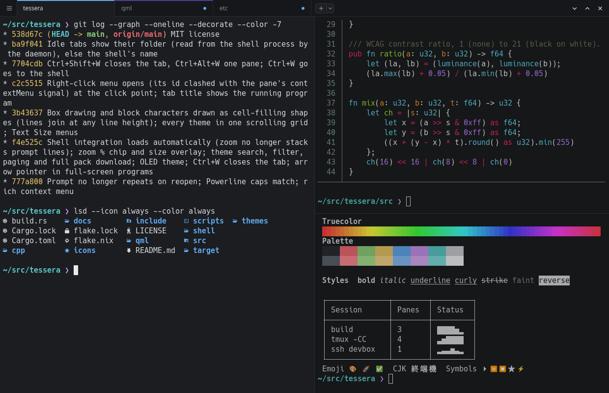
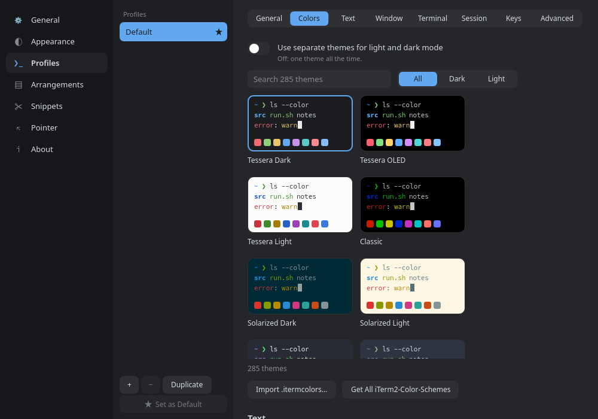

# Tessera

**A fast, good-looking terminal in the spirit of iTerm2 — for Linux first, cross-platform by design.**

Tessera pairs Ghostty's terminal engine with a native Qt Quick UI written in
Rust: tabs that look like tabs, splits, profiles, hundreds of color schemes,
built-in `tmux -CC`, and shells that survive closing the window.



<table>
<tr>
<td></td>
<td></td>
</tr>
<tr>
<td align="center">Tessera Light</td>
<td align="center">Tessera OLED — true black for OLED screens, bar included</td>
</tr>
</table>

## Highlights

- **Ghostty inside.** Emulation by [libghostty-vt](https://github.com/uzaaft/libghostty-rs): parsing, reflow, scrollback, Kitty keyboard protocol, mouse reporting, OSC 8 links, OSC 133 prompts.
- **Native text.** Rows are painted with QPainter (FreeType, glyphs on exact cells) only when they change, then composited as GPU textures. Box drawing and block characters are drawn as shapes, so lines join at any line height; Powerline and Nerd Font symbols keep their colors.
- **Shells that outlive the window.** A small daemon owns the shells. Close the window, update, or crash, and the next launch reattaches every shell — splits, scrollback, screen and all. After a reboot, tabs come back in their folders under their last screen.
- **`tmux -CC` built in.** tmux windows become native tabs and panes native splits.
- **Shell integration without setup.** zsh and fish load it automatically: command marks, jump between prompts, select a command's output, new tabs in the same folder, and prompts that redraw cleanly when the window or text size changes.
- **A modern window.** The tab bar is the title bar, with KDE-style buttons on the right. Tabs drag to reorder, out to a new window, or into another window, shells and all. A split **+** button opens profiles, other shells and SSH hosts from `~/.ssh/config`.
- **285 color schemes** built in (the permissively licensed part of [iTerm2-Color-Schemes](https://github.com/mbadolato/iTerm2-Color-Schemes)), searchable, with separate light and dark themes that follow the desktop. One click fetches the rest of the collection; `.itermcolors` files import.
- **An editor for commands.** At the prompt, an editor under the terminal: Enter runs, a tap of right Shift adds a line (no need for Shift+Enter), a tap of left Shift takes the grey suggestion from history or the AI; tree-sitter highlighting, shellcheck and language-server diagnostics, Emacs/vi/VS Code keys, a dropdown of commands, options and arguments with their man-page and tldr help (aliases followed: `ls` → `lsd`), merged shell history, and a prompt bar running your Starship.
- **AI, local or cloud.** Ollama, llama.cpp, LM Studio and other OpenAI-compatible servers, or Claude, OpenAI/Codex, Gemini, OpenRouter, Groq, Mistral, DeepSeek, xAI: grey suggestions as you type, `# describe it` → a command, checks before you run, ✦ Fix for a failed command, and an assistant sidebar that runs the commands it suggests when you click Run and reads their output.
- **Pictures and rich output.** Kitty and iTerm2 inline images, `cat photo.png` shows the photo, and JSON, CSV, HTML, Markdown and SVG output opens formatted with one click.
- **iTerm2's feature set:** profiles, find in scrollback (regex, smart case), triggers, minimum contrast, broadcast input, maximize pane, arrangements, snippets, paste history, badges, cursor guide, transparency, session logging, undo close, a rich right-click menu, and momentum scrolling that speeds up as you keep going.



## Install

Downloads for every platform are on the [releases page](https://github.com/benwbooth/tessera/releases/latest).

| | |
|---|---|
| **Linux: Flatpak** | `flatpak install --user https://benwbooth.github.io/tessera/flatpak/tessera.flatpakref` (or the `.flatpak` bundle from the release) |
| **Linux: AppImage** | download `Tessera-*-x86_64.AppImage`, `chmod +x` it, run it |
| **Nix** | `nix run github:benwbooth/tessera`, or add the flake's `packages.default` to your system |
| **macOS** | `brew install --cask benwbooth/tap/tessera`, or open the `.dmg` (Apple Silicon or Intel) |
| **Windows** | the `-setup.exe` installer, or the portable `.zip` |

The macOS app is signed ad hoc, not notarized (the Homebrew cask clears the
quarantine flag for you). Windows support is new: new tabs run PowerShell;
the + menu also has cmd.exe and each WSL distribution, and Shell › New
Administrator Window opens an elevated window.

## Like iTerm2

The ☰ menu (top left) is iTerm2's menu bar — Shell, Edit, View, Session,
Profiles, Window, Help — as native KDE/Breeze menus with icons and
shortcuts. Preferences mirror iTerm2's panels: General, Appearance,
**Profiles** (General, Colors, Text, Window, Terminal, Session, Keys),
Arrangements, Pointer. [docs/ITERM2-PARITY.md](docs/ITERM2-PARITY.md) lists
every iTerm2 menu item and setting with its status here.

The tab bar is the title bar (KDE-style window buttons on Linux, Windows' on
Windows, the native ones on macOS). Drag tabs to reorder them, out of the
window to make a new one, or onto another window to move them there; their
shells move along.

## Keys

iTerm2's Cmd shortcuts become Ctrl+Shift.

| | |
|---|---|
| New tab / window | Ctrl+Shift+T / Ctrl+Shift+N |
| Split right / down | Ctrl+Shift+D / Ctrl+Shift+E |
| Close tab / pane | Ctrl+Shift+W / Ctrl+Alt+W |
| Maximize pane | Ctrl+Shift+Enter |
| Terminal / notebook view | Ctrl+Shift+J |
| Editor ⇄ terminal (at a prompt) | Shift+Tab |
| Copy / paste | Ctrl+Shift+C / Ctrl+Shift+V (selecting also copies; Shift+Insert or middle click pastes the selection) |
| Select all / clear buffer | Ctrl+Shift+A / Ctrl+Shift+K |
| Find / next / previous | Ctrl+Shift+F / F3 / Shift+F3 (Enter / Shift+Enter in the find bar) |
| Next / previous tab | Ctrl+PgDn / Ctrl+PgUp, Ctrl+Tab, Alt+1…9 |
| Move tab | Ctrl+Shift+PgUp / Ctrl+Shift+PgDn |
| Move between panes | Ctrl+Alt+arrows, Ctrl+Shift+] / [ |
| Text size | Ctrl+= / Ctrl+- / Ctrl+0 (the % shows in the bar; click it for 100%) |
| Full screen | F11 |
| Find cursor | Ctrl+Shift+/ |
| Preferences | Ctrl+, |
| Leave tmux control mode | Esc in the tmux gateway tab |

## Build

```
nix develop -c cargo build
target/debug/tessera
```

The dev shell provides Qt 6 and Zig 0.15 (libghostty-vt's build compiles Ghostty).
Without Nix: Rust, Qt 6 (set `QMAKE` to its qmake) and Zig 0.15 on `PATH`, then
`cargo build --release`. Releases are built by `.github/workflows/release.yml`
(push a `v*` tag, or run it by hand to try the builds).

Testing: `--screenshot out.png` saves the window and quits, `--run CMD` types a command into the first terminal, `--then CMD` types another a few seconds later into whichever terminal has focus, `--prefs PAGE` opens Preferences (the screenshot is then of Preferences). Set `TESSERA_SOCKET`, `XDG_CONFIG_HOME` and `XDG_STATE_HOME` to keep a test run apart from your own sessions and settings.

Development: `devloop start tessera` (from home-services) rebuilds and restarts the window on every change; shells survive, since they live in the daemon.

## License

MIT — see [LICENSE](LICENSE). The bundled color schemes keep their own license (see [themes/](themes/)).
