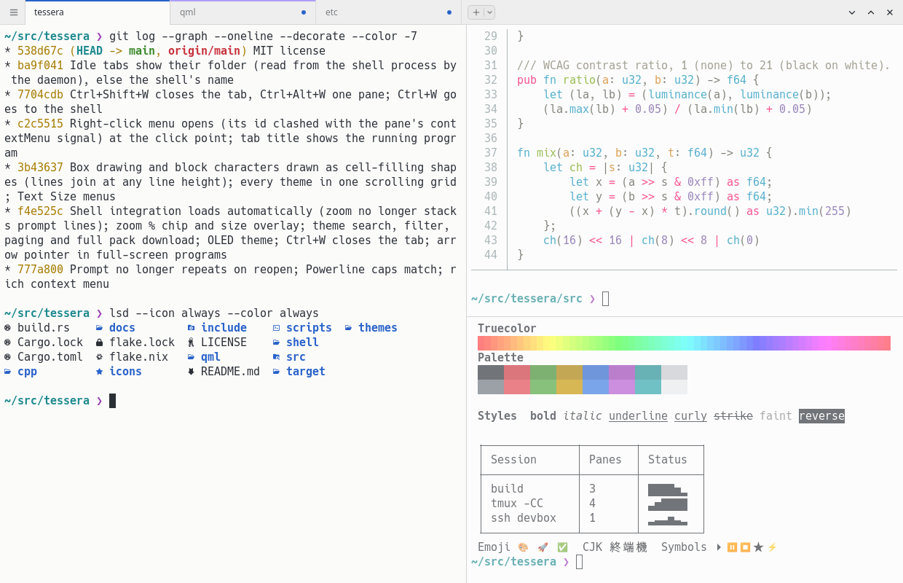
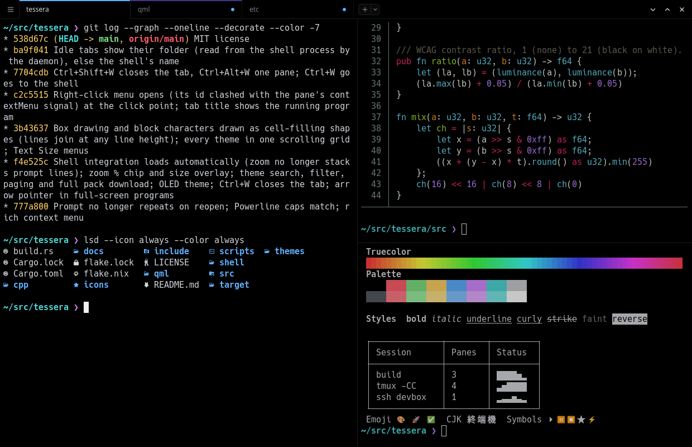

# Tessera

**A fast, good-looking terminal in the spirit of iTerm2 — for Linux first, cross-platform by design.**

Tessera pairs Ghostty's terminal engine with a native Qt Quick UI written in
Rust: tabs that look like tabs, splits, profiles, hundreds of color schemes,
and shells, notebooks and kernels that survive closing the window, here or on
an SSH host.


<table>
<tr>
<td></td>
<td></td>
</tr>
<tr>
<td align="center">Tessera Light</td>
<td align="center">Tessera OLED — true black for OLED screens, bar included</td>
</tr>
</table>

## Highlights

- **Ghostty inside.** Emulation by [libghostty-vt](https://github.com/uzaaft/libghostty-rs): parsing, reflow, scrollback, Kitty keyboard protocol, mouse reporting, OSC 8 links, OSC 133 prompts.
- **Native text.** Rows are painted with QPainter (FreeType, glyphs on exact cells) only when they change, then composited as GPU textures. Box drawing and block characters are drawn as shapes, so lines join at any line height; Powerline and Nerd Font symbols keep their colors.
- **Shells that outlive the window.** `tesserad`, a small backend in the spirit of tmux's server, owns the shells, the notebook kernels, each pane's notebook cells, and Nix runs. Close the window, update, or crash, and the next launch reattaches every shell and notebook — splits, scrollback, screen, running kernels and what they printed meanwhile. After a reboot, tabs come back in their folders under their last screen.
- **SSH hosts, the same way.** Pick a host from the + menu: its shells and notebook kernels run there, in that host's `tesserad`, reached through one shared SSH connection. A host without `tesserad` gets a static build of it copied over (to `~/.local/bin`, or `~`). Reconnecting attaches to what's still running there. Features that need Nix say how to install it when the host has none.
- **Shell integration without setup.** Every shell Tessera starts loads it automatically (zsh, bash, fish, nushell, xonsh, PowerShell), with no startup file edited: command marks, jump between prompts, select a command's output, new tabs in the same folder, and prompts that redraw cleanly when the window or text size changes.
- **A modern window.** The tab bar is the title bar, with KDE-style buttons on the right. Tabs drag to reorder, out to a new window, or into another window, shells and all. A split **+** button opens profiles, other shells and SSH hosts from `~/.ssh/config`.
- **285 color schemes** built in (the permissively licensed part of [iTerm2-Color-Schemes](https://github.com/mbadolato/iTerm2-Color-Schemes)), searchable, with separate light and dark themes that follow the desktop. One click fetches the rest of the collection; `.itermcolors` files import.
- **An editor for commands.** At the prompt, an editor under the terminal: Enter runs, a tap of right Shift adds a line (no need for Shift+Enter), a tap of left Shift takes the grey suggestion from history or the AI; tree-sitter highlighting, your shell's own syntax check (`zsh -n`, `bash -n`, `fish -n`; the chip names your shell) and language-server diagnostics, Emacs/vi/VS Code keys, a dropdown of commands, options and arguments with their man-page and tldr help (aliases followed: `ls` → `lsd`), merged shell history (↑/↓ line by line, PgUp/PgDn a whole entry at a time), and a prompt bar running your Starship. `# what you want` is finished in grey as you type, then becomes a command.
- **Any program in nixpkgs, from the command dropdown.** A command you don't have is offered with the package that has it (once per package when several do: `cowsay` from `cowsay` or `neo-cowsay`), and runs as `nix run nixpkgs#cowsay --` or `nix shell nixpkgs#ripgrep -c rg`. The index comes from nix-community's prebuilt [nix-index-database](https://github.com/nix-community/nix-index-database), fetched into `~/.cache/nix-index` (where `nix-locate` reads it too) and refreshed in the background when it's over a week old.
- **Other languages, typed at the prompt.** Text that isn't a shell command is recognised as the language it's in (the AI's guess, ranked by what you used lately; or pick it) and run with that language's usual script runner, the code given to it directly where it takes it (`python3 -c`, `rust-script -e`, `jbang --code` or JShell, `scala-cli run -e`, `kotlin -e`, `deno eval`, `bb -e`, `runghc` or GHCi, yaegi for Go, `tcc -run -` for C, clang-repl for C++ (C++23 with libc++'s `import std;`, nothing compiled first; cling or GCC 15 without Nix), `ocaml -stdin`, `sbcl --script`, `erl -eval`, `nim --eval`, `v -e`, ...), and `nix run nixpkgs#…` for one that isn't installed; packages through uv, Bun, rust-script's `-d`, or Go modules. In the notebook, a language with a Jupyter kernel runs in one kept alive between commands, so variables stay: Python, R, Julia, Ruby, Lua, Haskell, Rust (evcxr), Go, Deno, Kotlin, Scala, C and C++ (xeus-cpp, with the standard library and `import std;` ready), Octave, Scheme, Nix, gnuplot, and the shells (bash, zsh, PowerShell, xonsh), fetched with Nix or uv the first time. Each kernel starts in the shell's folder and environment and is kept in step with them; `input()` and the like ask in the card. The notebook bar's **Kernels** button lists the running ones (busy or idle, memory, uptime) with Restart, Stop and Stop all.
- **A prompt you arrange on the spot.** Drag the prompt's widgets along the bar (past the middle for the right side, off it to remove one), + adds any of Tessera's widgets or any Starship module, right-click restyles one, and Starship's whole prompt splits into its modules. A widget does things when clicked: a folder of the path goes up to it, the ▴ by the path opens your cd history (the five most used folders first, then recent ones, full paths, with a search), git switches branches, Kubernetes, AWS and gcloud switch contexts.
- **ls, cd and env, by mouse.** In the notebook, an `ls` card (lsd, eza, aliases) is a file browser that reads like `ls` output: list, tiles (with thumbnails) or details (`ls -l` columns, colored), sorted as you choose, each card keeping its own view (and the last one becoming the default). A click goes into a folder or opens a file; back, forward and up; a right click has Dolphin's menu (View, Open with its app, cd, insert or copy the path, copy/cut/paste, rename, duplicate, trash, show in the file manager, properties). Files drag out to other apps and in from them (dropped on the editor, their paths are typed). `cd` shows the folder it went to. An `env` card is the shell's variables to edit: a new value exports it, × unsets it. `cd ` completes from frecent folders (zoxide and your history), folders below and `CDPATH`, fuzzily; `ls `, `export ` and `unset ` open their dropdown at once.
- **View any file.** Right click > View in a listing, or on a path in the terminal, shows it over the pane: pictures fitted (click for actual size), Markdown, JSON, tables, HTML and SVG formatted, code highlighted.
- **AI, local or cloud.** Ollama, llama.cpp, LM Studio and other OpenAI-compatible servers, or Claude, OpenAI/Codex, Gemini, OpenRouter, Groq, Mistral, DeepSeek, xAI: grey suggestions as you type, `# describe it` → a command, checks before you run, ✦ Fix for a failed command, and an assistant sidebar that runs the commands it suggests when you click Run and reads their output. On the [Hearth](https://github.com/benwbooth/hearth) desktop it uses Hearth's AI hub by default (Preferences › AI › Hearth AI hub): the models picked in Hearth's Settings › AI › Apps (its "fast" model for suggestions and checks, "default" for the rest), loaded and unloaded by Hearth's memory manager with the rest of the desktop's; without Hearth, the models you set answer.
- **Notebooks.** (More in [Notebook mode](#notebook-mode) below.) Ctrl+Shift+J opens a notebook tab, and it's a Jupyter notebook too. Each command you run becomes a card with its output in its own resizable pane (Expand fills the window), shown for what it is: Markdown as a page or as terminal-style text, JSON, tables, HTML, pictures. You can also write cells there, Markdown between them, and run them in the pane's own shell or a Jupyter kernel (any installed kernel, or Python fetched by Nix with numpy, pandas and matplotlib), with completion from the kernel and plots, tables and colored tracebacks inline. With a kernel picked, the editor at the bottom writes the next cell. A pane's notebook is kept across restarts; Save as .ipynb makes it a file. `.ipynb` files open the same way (Ctrl+O, or `tessera notes.ipynb`). Alt+drag selects a block of output. Cards fill up from the bottom by the editor, like a terminal, the view follows new ones, output lines use the terminal's font and row height, and Shift+Tab gets back to the editor from anywhere (Markdown and HTML views too).
- **Pictures and rich output.** Kitty and iTerm2 inline images (Kitty's Unicode placeholders too, as `mdfried` uses), `cat photo.png` shows the photo, and JSON, CSV, HTML, Markdown and SVG output opens formatted with one click.
- **Screenshots and recordings.** Session › Screenshot of Pane / of Window saves a PNG to `~/Pictures/Screenshots` and copies it; Record Pane (asciicast) records a pane's output to `~/Videos/Tessera/*.cast`, and offers a GIF (agg) when it stops.
- **iTerm2's feature set:** profiles, find in scrollback (regex, smart case), triggers, minimum contrast, broadcast input, maximize pane, arrangements, snippets, paste history, badges, cursor guide, transparency, session logging, undo close, a rich right-click menu, and momentum scrolling that speeds up as you keep going.


## Install

Downloads for every platform are on the [releases page](https://github.com/benwbooth/tessera/releases/latest).

| | |
|---|---|
| **Linux: Flatpak** | `flatpak install --user https://benwbooth.github.io/tessera/flatpak/tessera.flatpakref` (or the `.flatpak` bundle from the release) |
| **Linux: AppImage** | download `Tessera-*-x86_64.AppImage`, `chmod +x` it, run it |
| **Nix** | `nix run github:benwbooth/tessera`, or add the flake's `packages.default` to your system |
| **macOS** | `brew install --cask benwbooth/tap/tessera`, or open the `.dmg` (Apple Silicon or Intel) |
| **Windows** | the `-setup.exe` installer, or the portable `.zip` |

The macOS app is signed ad hoc, not notarized (the Homebrew cask clears the
quarantine flag for you). Windows support is new: new tabs run PowerShell;
the + menu also has cmd.exe and each WSL distribution, and Shell › New
Administrator Window opens an elevated window.

## Notebook mode

Ctrl+Shift+J (or **New Notebook Tab** in the + menu) opens a notebook tab: a
shell whose commands show as cards instead of a scrolling screen. A tab is a
terminal or a notebook from the moment it opens and stays that way (its splits
too); the shell and the cards are kept in tesserad, so closing the window loses
nothing.

**Cards.** Every command becomes a card: a ✓ or ✘ (hover it for the exit
code and what it means for that program, read from its man page, or asked of
the AI when the page doesn't say), the shell or kernel that ran it, the
command, the full folder it ran in, how long it took and when. Its output is
shown for what it is: a terminal screen, Markdown (as a page or as styled
text), JSON, CSV/TSV as a table, HTML, SVG, pictures, diffs, `ls` as a file
browser, `env` as variables to edit. A card's ⋯ menu moves, hides, reruns or
deletes it; drag its bottom edge to resize, ⤢ Expand to fill the window.
Full-screen programs (vim, htop, mdfried) take the whole pane while they
run, then the notebook comes back. Cards fill up from the bottom by the
input, like a terminal, and a notebook opens scrolled to its newest.

**Kernels.** The input's language list picks what runs the next command:
the pane's own shell, another shell (bash, zsh, fish, nushell, xonsh,
PowerShell, elvish, tcsh: run as a kernel kept alive beside the pane, not a
nested interactive shell), or any language with a Jupyter kernel (Python, R,
Julia, Rust, C/C++, Haskell, Ruby and more, fetched with Nix or uv the first
time; Nix environments are built once and cached). Environment variables and
the current folder carry over between them both ways, so `export X=1` in
fish is there in zsh next. Each card remembers what ran it. The notebook
bar's kernel picker sets the default for written cells, and **Kernels** lists
the running ones with Restart and Stop.

**Writing cells.** + Code and + Markdown add cells to write and run; Enter
runs and moves on, Ctrl+Enter runs, Alt+Enter runs and adds one below. The
kernel's completion, `input()` prompts, plots and tracebacks show in the card.
Save as .ipynb writes a Jupyter notebook; `.ipynb` files open the same way.

**Files.** Clicking a text file in an `ls` card (or Right click › View) opens
it in a file card: Tessera's own viewer, with line numbers, syntax
highlighting (tree-sitter; the type chip picks another language), scroll bars
and paging, streaming so a file of any size opens at once. In the card:

- **✎ Edit** edits it in place with your Emacs, vi or VS Code keys (the keys
  chip shows which, and vi's NORMAL/INSERT), block cursor, PgUp/PgDn,
  Ctrl+S to save. ✓ Save writes it, ✕ Discard drops the changes. Line
  endings (LF/CRLF) are kept, and can be switched.
- The ⋯ menu has Save as…, Find and replace (Ctrl+F / Ctrl+H, F3 for the
  next match), Go to line (Ctrl+G), Undo/Redo, Wrap long lines and the
  line-ending switch; Ctrl+F/H/G also show a bar of them.
- **Edit in your $EDITOR** opens the file in a small terminal inside the card
  (`$VISUAL`, then `$EDITOR`, then vi), or pick Vim, Neovim, Emacs, Helix,
  micro, nano or Kakoune; one that isn't installed runs with
  `nix run nixpkgs#…`. Quit it and the card shows the file as saved.
- **CSV and TSV** files open as a table, even huge ones (read into SQLite in
  the background): sort by a header, filter, drag columns to reorder,
  hide or show them, and query with SQL (a WHERE clause or a whole SELECT).
  Double-click a cell to edit it, + Row / − Row, or run UPDATE/INSERT/DELETE;
  Save writes the file back (Save as… elsewhere).

A remote pane's files are read, edited and saved on that host, through its
tesserad.

## tessh

tessh is Tessera's own shell language. You write it like a shell, and underneath
it is Python: every line compiles to Python, so the whole language and every
Python package work in it. Indentation gives it structure, like a Lisp whose
lines take the place of parentheses. It has Python's infix operators, the shell
operators (`|`, `&&`, `||`, `>`, `2>&1`, `&`), and hygienic macros.

```tessh
ls -la ~/src | grep tessera          # a name that isn't Python's runs a program
name = world
print hello $name                    # barewords are strings, $ is a variable

def fib n
  if $n < 2
    $n                               # the last form is the value (implicit return)
  else
    fib ($n - 1) + fib ($n - 2)      # calls bind tighter than operators

branch = git rev-parse --abbrev-ref HEAD    # output captured as a string
if git diff --quiet
  print clean

defmacro unless cond:expr *body
  quasi
    if (not ~cond)
      ~@body
```

- It runs in a pane (`tessh`, a REPL with auto-indent, highlighting and
  completion), as scripts (`tessh file.tsh`, `#!/usr/bin/env tessh`), and as
  a notebook kernel. It's what a notebook runs commands and cells in by
  default (Preferences › General › Notebook kernel, or `notebook_kernel` in
  the settings, picks another: any kernel, a shell, or the pane's own shell;
  a notebook's kernel list picks one for that notebook). The folder and
  exported variables go between it and the pane's shell as with the other
  kernels.
- `help` shows the guide, a topic at a time (`help pipes`, `help macros`):
  Markdown in a notebook, highlighted in a terminal. `help $obj` is Python's
  help. With tessh as a notebook's kernel, **Manual** beside the kernel list
  (or F1) opens the whole guide as a page, with contents and find.
- It takes what fits a shell from Clojure: `.method obj` calls, `->`/`->>`
  chaining, `doto`, `:key` getters, `{a b} = $d`, `fn ($% * 2)`, `#_` and
  the core sequence functions. And from Hy: `.tsh` files import as modules
  (from Python too), `require` brings in a module's macros, `let` scopes
  names to a block, and `py "…"` is Python as written.
- The input editor highlights tessh and checks it as you type (`tessh
  --check`). Enter indents after `def`, `if` and the like, and an `else` goes
  back to its `if`.
- Python's tracebacks point at tessh lines. `tessh --py file.tsh` shows the
  Python it compiles to.
- A `# /// script` block (PEP 723) names PyPI packages, and uv installs them.
- `\cat` runs the program even when a Python `cat` exists.

The language is described in [docs/TESSH.md](docs/TESSH.md), and the guide,
with an example for each part of it, is [tessh/doc/guide.md](tessh/doc/guide.md)
(every example there is run by the tests). The
[Advanced tessh Scripting Guide](tessh/doc/advanced/00-introduction.md) is the
Advanced Bash-Scripting Guide ported, every example in bash and tessh side by
side. All of tessh's documentation, and how to install it on its own (one
file from the releases, nothing else needed), is in [tessh/](tessh/README.md),
and as a site at [benwbooth.github.io/tessera/tessh](https://benwbooth.github.io/tessera/tessh/).
tessh is built with Tessera (`nix run github:benwbooth/tessera#tessh` on its
own).

## tesserad

`tesserad` is Tessera's backend, like tmux's server: it owns every shell,
notebook kernel, card and Nix run, and the window is a client of it. Close
the window, update Tessera, or let it crash, and everything keeps running;
the next window reattaches, with the screen, scrollback and whatever was
printed meanwhile. A new build of tesserad replaces the running one in place
without dropping the shells.

Over SSH it works the same way. Pick a host from the + menu (or `~/.ssh/config`'s
hosts listed there): Tessera opens one shared SSH connection, runs that host's
tesserad and talks to it through a forwarded socket, so the host's shells,
kernels and notebooks survive the connection dropping and reattach on the next
one. If the host has no tesserad, a static Linux build is copied there first
(to `~/.local/bin`, else `~`). Files, tables, completion, the prompt bar and
exit-code meanings are all read on the host. When a feature needs Nix and the
host has none, Tessera says how to install it.

## Like iTerm2

The ☰ menu (top left) is iTerm2's menu bar — Shell, Edit, View, Session,
Profiles, Window, Help — as native KDE/Breeze menus with icons and
shortcuts. Preferences mirror iTerm2's panels: General, Appearance,
**Profiles** (General, Colors, Text, Window, Terminal, Session, Keys),
Arrangements, Pointer. [docs/ITERM2-PARITY.md](docs/ITERM2-PARITY.md) lists
every iTerm2 menu item and setting with its status here.

The tab bar is the title bar (KDE-style window buttons on Linux, Windows' on
Windows, the native ones on macOS). Drag tabs to reorder them, out of the
window to make a new one, or onto another window to move them there; their
shells move along.

## Keys

iTerm2's Cmd shortcuts become Ctrl+Shift.

| | |
|---|---|
| New tab / window | Ctrl+Shift+T / Ctrl+Shift+N |
| Split right / down | Ctrl+Shift+D / Ctrl+Shift+E |
| Close tab / pane | Ctrl+Shift+W / Ctrl+Alt+W |
| Maximize pane | Ctrl+Shift+Enter |
| New notebook tab | Ctrl+Shift+J |
| Editor ⇄ terminal (at a prompt); back to the editor from a notebook or viewer | Shift+Tab |
| Editor history: line by line / whole entries | ↑/↓ / PgUp/PgDn |
| Open a Jupyter notebook | Ctrl+O (New Jupyter Notebook in the Shell menu) |
| Notebook cell: run and go on / new line / run / run and add below | Enter / right Shift tap or Shift+Enter / Ctrl+Enter / Alt+Enter |
| Notebook, between cells | ↑/↓ or j/k move, Enter edits, Esc leaves a cell, A/B add above/below, D D deletes (Z undoes), M/Y Markdown/code, O hides output, Ctrl+S saves |
| Block (column) selection | Ctrl+Alt+drag in the terminal, Alt+drag in notebook output |
| Copy / paste | Ctrl+Shift+C / Ctrl+Shift+V (selecting also copies; Shift+Insert or middle click pastes the selection) |
| Select all / clear buffer | Ctrl+Shift+A / Ctrl+Shift+K |
| Find / next / previous | Ctrl+Shift+F / F3 / Shift+F3 (Enter / Shift+Enter in the find bar) |
| Next / previous tab | Ctrl+PgDn / Ctrl+PgUp, Ctrl+Tab, Alt+1…9 |
| Move tab | Ctrl+Shift+PgUp / Ctrl+Shift+PgDn |
| Move between panes | Ctrl+Alt+arrows, Ctrl+Shift+] / [ |
| Text size | Ctrl+= / Ctrl+- / Ctrl+0 (the % shows in the bar; click it for 100%) |
| Full screen | F11 |
| Find cursor | Ctrl+Shift+/ |
| Preferences | Ctrl+, |

## Build

```
nix develop -c cargo build
target/debug/tessera
```

That builds both `tessera` (the window) and `tesserad` (the backend, a crate
of its own in `tesserad/` with no Qt). The static `tesserad` copied to SSH
hosts: `nix build .#tesserad-static` (the `tessera` package carries it in
`libexec/tessera/tesserad-<arch>-linux`; elsewhere set
`TESSERA_TESSERAD_STATIC` to it).

The dev shell provides Qt 6 and Zig 0.15 (libghostty-vt's build compiles Ghostty).
Without Nix: Rust, Qt 6 (set `QMAKE` to its qmake) and Zig 0.15 on `PATH`, then
`cargo build --release`. Releases are built by `.github/workflows/release.yml`
(push a `v*` tag, or run it by hand to try the builds).

Testing: `--screenshot out.png` saves the window and quits, `--run CMD` types a command into the first terminal, `--then CMD` types another a few seconds later into whichever terminal has focus, `--prefs PAGE` opens Preferences (the screenshot is then of Preferences). Set `TESSERA_SOCKET`, `XDG_CONFIG_HOME` and `XDG_STATE_HOME` to keep a test run apart from your own sessions and settings.

Tests: `cargo test -p tesserad` runs tesserad end to end on a scratch socket (cells kept while no window is attached, kernels reattaching); `TESSERA_TESSERAD_STATIC=… cargo test -p tesserad -- --ignored ssh_localhost` deploys it over `ssh localhost` into a scratch home.

Development: `devloop start tessera` (from home-services) rebuilds and restarts the window on every change; shells and kernels survive, since they live in tesserad.

## License

MIT — see [LICENSE](LICENSE). The bundled color schemes keep their own license (see [themes/](themes/)).
